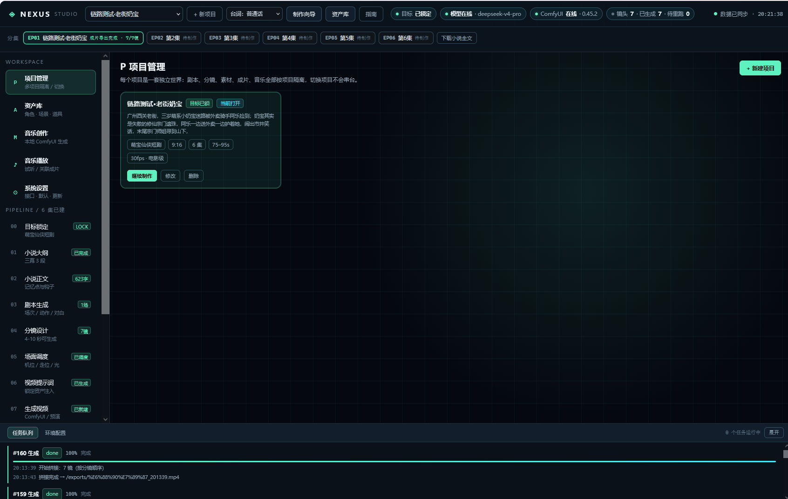
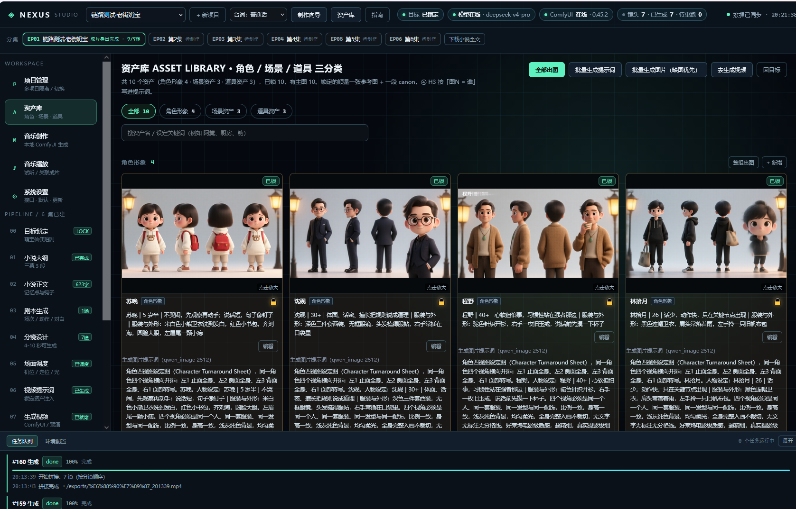
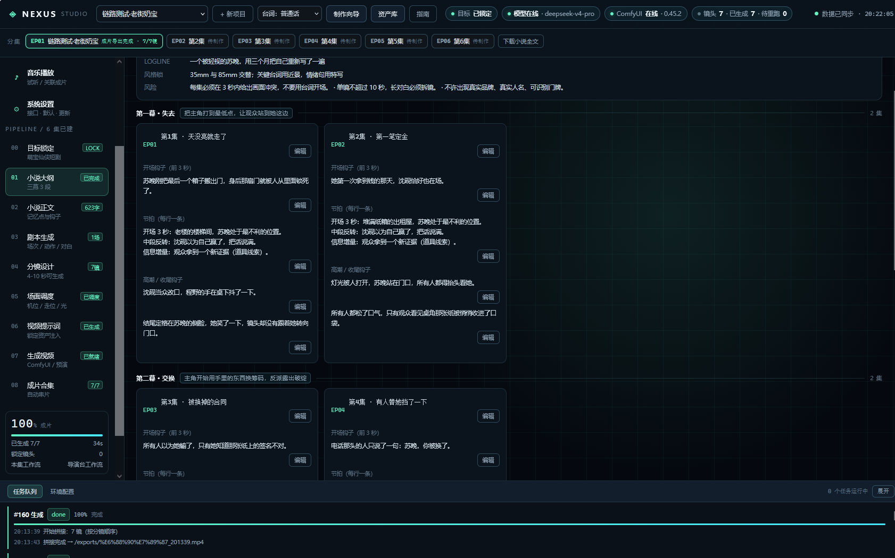
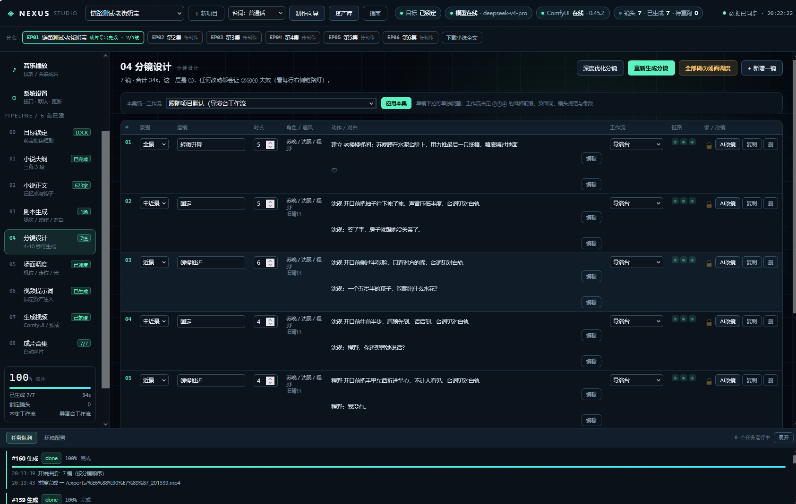

# NEXUS STUDIO · AI 视频创作系统

参考 aigcsi.cn 的短剧生产五段流程与本机 Java 版平台的分镜管理逻辑，重新搭建的一条**可离线跑通**的 AI 视频创作流水线。

- 启动：双击 `一键启动.bat`（平台 + ComfyUI 一起起）
- 地址：http://127.0.0.1:18081
- 数据：`data/studio.db`（SQLite，WAL）；产物：`data/media`、`data/exports`
- 依赖：只用 Python 标准库 + 原生 JS，**不装任何第三方包**，不需要 Node、不需要 npm
- ComfyUI 由平台自己管：启动守护线程每 45 秒探一次端口（TCP），掉了就清僵尸进程再拉起来；
  提交生成前还会再确认一次，**拉不起来就判失败**，绝不用预演帧冒充真片。日志在 `data/comfy.log`。

## 界面预览

| 项目管理 | 资产库（角色 / 场景 / 道具锁定） |
|---|---|
|  |  |

| 小说大纲 / 分集剧本 | 分镜设计（镜头表） |
|---|---|
|  |  |

## 功能特性

- **九步工作台**：00 目标锁定 → 01 小说大纲 → 02 小说正文 → 03 剧本 → 04 分镜 → 05 场面调度 → 06 视频提示词 → 07 生成视频 → 08 成片合集，外加 09 资产库。
- **级联失效**：上游设定（动作、对白、时长、景别、机位、运镜、资产特征、风格锁等）一改，下游自动标「待重跑」并保留旧产物，不会拿老片冒充新片。
- **资产一致性**：角色 / 场景 / 道具四视图出图后锁定，按镜绑定参考图，跨镜续接自动抽上一镜末帧。
- **离线降级**：ComfyUI 或 LLM 不可用时回退到本地引擎 / 调度预演帧，并明确标注，不假装出片。
- **成片合集**：可选镜头范围，导出可独立播放的 HTML 合集，或用 ffmpeg 合成 MP4。
- **本地优先**：后端只用 Python 标准库 + 原生 JS，不需要 Node、不需要 npm install。

## 环境要求

- Python 3.9 及以上（后端仅用标准库，无需 `pip install` 第三方包）。
- 可选本地 ComfyUI（默认端口 8188）用于出图与出视频；ffmpeg 用于抽帧、抽末帧与合成 MP4。
- 可选 LLM（如 DeepSeek）：填入 API Key 后走大模型创作；不填则用内置本地引擎兜底。
- 平台默认端口 18081（可用环境变量 `STUDIO_PORT` 覆盖），ComfyUI 端口 8188。

## 安装与启动

1. 克隆或下载本仓库到本地目录。
2. 方式一：双击 `一键启动.bat`（同时拉起 ComfyUI 与平台）。
   方式二：脚本失效时手动启动——在项目目录执行 `python app.py`。
3. 浏览器打开 `http://127.0.0.1:18081/`。
4. 停止：双击 `一键停止.bat`（直接关窗口不会停掉后台服务）。

> 首次启动会自动创建空的 `data/` 目录与 SQLite 库；仓库本身不携带任何项目数据、媒体产物或日志。

## 首次配置

进入「系统设置」页按本机情况填写（默认值均为空，不写入任何本机绝对路径）：

- **文本模型**：`llm_base_url` / `llm_api_key` / `llm_model`，引擎模式 `auto | llm | local`。
- **本地 ComfyUI**：`comfy_base`、`comfy_python`、`comfy_yaml`、`comfy_input_dir`、`comfy_output_dir`。
- **ffmpeg**：`ffmpeg_path`，指向本机 ffmpeg 可执行文件。
- **图 / 视频 / 音乐 / 配音通道**：可切本地 ComfyUI 或线上接口；未配置的通道不会假装配齐。
- **版本更新提示**：`app.py` 顶部 `UPDATE_MANIFEST_URL` 留空表示不联网检查；填一个可公网访问的 JSON 清单地址后，旧版本打开时会提示更新。清单格式见 `update-manifest.example.json`。

## 目录结构

```
NEXUS-STUDIO-AI视频创作系统/
├─ 一键启动.bat / 一键停止.bat      # 启停封装
├─ start_services.ps1 / stop_services.ps1
├─ app.py                          # 后端主服务（HTTP + SQLite + 流水线 + 出片）
├─ engine.py                       # 本地创作引擎（大纲 / 正文 / 剧本 / 提示词）
├─ frames.py                       # 分镜预演 SVG 帧
├─ static/                         # 前端页面、脚本、样式、群二维码
├─ docs/                           # 提示词规范与界面截图
├─ workflows/                      # ComfyUI 工作流预设目录
├─ data/                           # 运行数据（不入库：数据库 / 媒体 / 成片 / 日志）
├─ README.md                       # 本文件
├─ 使用说明.md                      # 详细操作说明
└─ 快速上手.txt                     # 30 秒上手
```

## 社区与支持

- 作者 QQ：`229611621`
- QQ 交流群二维码：`static/qq-group-qrcode.jpg`（前端「社区交流」弹窗内可点击放大）
- 反馈问题、获取新版本、交流提示词经验可加群。

## 一、流水线（级联失效是核心）

```
① 资产 / 分镜描述 / 对白  →  ② 场面调度  →  ③ 视频提示词  →  ④ 生成视频  →  合集
```

① 一旦改动（分镜动作、对白、时长、景别、运镜、角色/道具/场景 canon、风格锁、画幅、禁区）→ ②③④ 立刻标记「需重跑」，且**不会自动删除已生成的结果**，而是打上失效徽章让你决定重跑哪一段。

实现方式：每一层落库时记下上游内容的指纹，读的时候实时比对，不依赖定时器、不依赖内存：

| 层 | 落库字段 | 比对对象 |
|---|---|---|
| ② | `sig1_at_block` | `shot_sig1` = hash(动作+对白+时长+景别+机位+运镜+场次+情绪+转场+三类资产 canon+风格锁+画幅+禁区) |
| ③ | `sig2_at_prompt` | `shot_sig2` = hash(blocking_json + duration) |
| ④ | `sig3_at_gen` | `shot_sig3` = hash(prompt_cn + prompt_en + prompt_neg) |

集级另有 `outline_stale / novel_stale / script_stale / board_stale`，靠 `proj_sig → sha(outline) → sha(novel) → sha(script)` 逐级比对。

## 二、九步工作台

| 步 | 名称 | 干什么 |
|---|---|---|
| 00 | 目标锁定 | 题材/平台/画幅/集数/风格/禁区分区锁死；**未锁定不允许 AI 动手**（接口返回 400） |
| 01 | 小说大纲 | 12 集结构：每集钩子、爽点、结尾反转；同时抽出角色/场景/道具 canon |
| 02 | 小说正文 | 每集 600-800 字正文，写细节不写评价 |
| 03 | 剧本生成 | 拆 6 场左右，场次/时间/地点/动作/对白（单句 ≤ 24 字，按 4.5 字/秒控长） |
| 04 | 分镜设计 | 每场 1 建立 + 每句台词 1 镜 + 1 反应镜，4-10 秒/镜，总时长对齐单集目标 |
| 05 | 场面调度 | 机位高度/轴线/焦距/走位/构图/光位/色温/节拍；右侧 SVG 预演帧按这些参数实时画出来 |
| 06 | 视频提示词 | 六段式中文主提示（主体/场景/动作/镜头/光/风格）+ 英文补充 + 负面词，资产 canon 原样注入；**卡里另有「H3 提交原文」，逐字等于送进 ComfyUI 的字符串**（参考图编号映射 + 主提示 + 负面 + 硬约束） |
| 07 | 生成视频 | ComfyUI 在线走本地 MiniMax H3 参考生视频；进度条按本机实测（初始化 ~100s + 每步 ~80s）折算，秒级同步；离线自动降级为「调度预演」片段并标注 |
| 08 | 成片合集 | 一键导出内联 SVG 帧的可独立播放 HTML；有真视频时自动换成真片段 |

## 二·四、本地出图（qwen_image_2512）

资产图不是外部搜来的，是**本机 ComfyUI 现出**：

- 模型：`qwen_image_2512_fp8_e4m3fn` + `qwen_2.5_vl_7b_fp8_scaled`(CLIP type=qwen_image) + `qwen_image_vae` + Wuli 2step Turbo LoRA + `ModelSamplingAuraFlow(shift=3)`，KSampler 2 步 / cfg 1.0 / euler simple
- 尺寸：角色四视图 1664×928、角色单图 1104×1472、场景 928×1664、道具 1328×1328
- 入口：`POST /api/assets/{id}/image`，body `{mode:"four"|"single"|"reroll", seed?}`；`POST /api/projects/{id}/images` 整组出图（`{kind:"char"|"scene"|"prop"|""}`）
- 角色默认出**四视图**（正/侧/背/特写同框，同人同装同发型）；场景强制**空镜无人**（canon 里的人物动作在出图前被剥掉，否则模型一定画人）
- 每张图落 `asset_images` 表，同一资产保留多版：可**选为锁定图**、**删除某一版**、**重出**、**下载原图**、点击**放大**（灯箱）
- 首张图自动成为该资产的锁定参考图（同时回写 `image_url` + `locked=1`）；之后出图不抢占，由「选」按钮决定

## 二·五、资产库（角色形象 / 场景资产 / 道具资产）

右侧栏常驻「资产库 / ASSET LIBRARY」，**不折叠不隐藏**，任何视口下都在，并按三类分区：

- **角色形象**（char）：卡片主图 + 已锁角标 + 版本缩略；按钮「出四视图 / 单图 / 重新生成 / 下载」
- **场景资产**（scene）：竖构图空镜环境板，「生成本图 / 重新生成 / 下载」
- **道具资产**（prop）：方图设定图，「生成本图 / 重新生成 / 下载」
- 每组标题旁有「整组出图」；底部统计条有「全部出图」
- 每条资产 = **canon 文本 + 参考图 + 锁定状态**；canon 是可直接改的文本框（手动修改），改完立刻让下游失效
- 每张图下面一排缩略：点「选」把它设为锁定参考图（绿框为当前锁定），点「×」删除该版本，点缩略图放大预览
- 出图进行中，资产面板顶部出现**画幅进度条**（出图中 N% + 最新一条日志），与右下任务队列同步
- 已生成过的资产按钮依旧是「重新生成」，随时可以再出一版，不会锁死
- 锁定后 ③ 提示词原样注入 canon，④ 生成时把该镜用到的角色/道具/场景参考图作为多模态输入，提示词首行写明「图1 = 阿棠 / 图2 = 城郊的老宅厨房」
- 无参考图也能锁，但会明确标成「仅文本锁：无参考图，一致性不保证」——图和文本双锁才是真锁
- 示例项目现已 10 项资产全部出图锁定（4 角色 + 3 场景 + 3 道具），产物在 `data/media/*.png`，首版种子图在 `data/media/refs`
- 场景资产自动跟着剧本走：剧本里出现的新地点会就地顶掉占位场景（主场/对手场/中转场），不会越积越多

右栏顶部另有一张常驻「目标速览卡」：题材 / 画幅 / 集数 / 单集时长 / 风格锁 / 是否已锁，点一下直接跳回 00 步改。

## 三、深度优化（AI 深度思考优化修复）

每个阶段都能点「深度优化」，实现是**三轮「诊断 → 修复 → 复核」**，逐条写进控制台任务日志：

- 大纲：补集数、补每集钩子、补主线因果
- 正文：不足 600 字补写、缺主角名告警、结尾缺钩子自动补一句
- 剧本：>24 字长台词在标点处拆成两句，并补「承接」情绪
- 分镜：景别重复自动错开、异常时长回写 4-10 秒
- 调度：缺轴线补轴线、缺光位补色温、节拍少于 3 段补足
- 提示词：语速 > 5.2 字/秒抬时长、单镜 > 10s 压缩、角色未锁告警、负面词补齐（水印/文字/变形）、>520 字按六段优先级截断

**幂等**：每轮重新读库、只统计真实发生的 DB 变更，所以第二轮开始计数不再上涨（`test_e2e.py` 会打印三轮日志）。

## 四、不刷新丢状态

- 后端所有状态都在 SQLite 里，进程重启也不丢
- 前端把 `项目 id` 与 `当前步骤` 存 localStorage，刷新后自动回到原来的步骤并提示「已恢复上次进度」
- 正在输入的单元格不会被打断：编辑中跳过整页重绘，失焦或停手 850ms 后自动保存
- 顶部「数据已同步 hh:mm:ss」每 2.5s 轮询 `/api/state`

## 五、离线降级策略

| 依赖 | 探测 | 降级 |
|---|---|---|
| LLM（DeepSeek 等） | `engine_mode=auto` 先用模型 | 失败/余额不足自动回落本地创作引擎（engine.py 的中文模板 + 结构规则） |
| ComfyUI | `http://127.0.0.1:8188` | 无监听 → 用 frames.py 生成的 SVG「调度预演帧」代替真视频 |
| ffmpeg | PATH 里找 | 找不到 → 合集导出用 HTML 播放器（可双击打开），MP4 按钮明确报「未配置 ffmpeg」 |

前端「环境配置」页可以随时改 LLM Key / Base / Model、ComfyUI 地址、工作流文件名、engine_mode，以及 **H3 采样步数 / 分辨率缩放**（步数 8 = 质量档，4 = 速度翻倍；缩放 1.0 = 满档，0.7 ≈ 快速验证）。本机实测：8 步 / 768×1344 / 5s ≈ 754s 一镜（初始化约 100s + 每步约 80s）。

## 五·五、H3 视频提示词的真正形态

③ 页每张卡最下面那块「H3 提交原文」就是送进 ComfyUI 的字符串，结构固定为：

```
【参考图锁定（按顺序）】
图1 = 阿棠
图2 = 城郊的老宅厨房
...
【主体】…【场景】…【道具】…【动作】…【镜头】…【构图】…【光线】…【调度】…【风格】…【对白】…
画面里不要出现：画面文字, 水印, logo, 字幕硬字, 多余手指, 变形脸, 换装, …
【硬约束】时长 5 秒｜画幅 9:16｜24fps｜无字幕｜无水印｜不换脸不换装
```

图号映射是硬约束：H3 靠 `ref_image_1..N` 绑定参考图，提示词里不写「第几张图是谁」就会串脸；硬约束则把时长/画幅/帧率/无水印写死。卡上有「复制 H3 原文」，可直接丢进 ComfyUI 手工跑同一份。

## 六、文件

| 文件 | 作用 |
|---|---|
| `app.py` | HTTP 服务、SQLite schema、签名与失效判定、任务队列、LLM/ComfyUI 接入、API、seed、合集导出 |
| `engine.py` | 本地创作引擎：大纲/正文/剧本/分镜/调度/提示词 + 四类审计修复 |
| `frames.py` | 把调度数据渲染成 SVG 预演帧（景别→人物占画比、机位→地平线、光位→色偏、走位→站位、台词→字幕条） |
| `static/` | 工作台前端（index.html / style.css / app.js） |
| `seed_refs.py` | 给资产下载并绑定参考图（示例项目 10 张），同时把资产置为锁定 |
| `test_e2e.py` | 全链路自检（含 ④ 生成），14 项，跑完自动清理自检项目 |
| `test_chain.py` | 轻量链路自检，23 项，只验 ①→②→③ + 级联失效 + 资产图接口，不触发 GPU |
| `run_videos.py` | 顺序跑全部镜头真视频的批处理脚本（跳过已有真片的镜头） |
| `一键启动.bat` + `start_services.ps1` | 一键先起 ComfyUI（8188）再起平台（18081），都探活后自动开浏览器 |
| `一键停止.bat` + `stop_services.ps1` | 按命令行匹配停掉 app.py 与 ComfyUI main.py |

## 七、常用 API

```
GET  /api/state                       全站状态（项目/集/镜头/资产/任务/步骤）
POST /api/project                     新建项目
POST /api/target/lock                 锁定目标（未锁定前禁止生成，接口返回 400）
POST /api/generate/{kind}             kind = outline|novel|script|board|blocking|prompt|video|optimize
                                       body: {project_id, episode_id, shot_id?, stage?}
POST /api/assets                      新增资产（kind/name/canon/image_url/locked）
POST /api/assets/{id}                 改资产（name/canon/image_url/locked 任一变动都会让下游失效）
POST /api/assets/{id}/image           出图 body {mode:"four"|"single"|"reroll", seed?, prompt?}
POST /api/projects/{id}/images        整组出图 body {kind?}
POST /api/images/{iid}/choose         把某一版设为锁定参考图
DELETE /api/images/{iid}              删除某一版（删掉的若在锁定位，自动回落到最新一版）
GET  /media/{file}                    产物直链（出图 / 真视频 / 种子参考图）
GET  /api/shots/{id}/frame.svg        单镜预演帧（按当前调度参数实时渲染）
GET  /api/reel?project=               合集时间线数据
POST /api/reel/export                 导出内联 SVG 的可独立播放 HTML
POST /api/reel/ffmpeg                 尝试用 ffmpeg 合成 MP4（本机未装时会明确报错）
GET  /api/job/{id}                    任务日志（前端控制台逐条流式显示）
```

## 八、自检

```
python test_e2e.py
```

覆盖：未锁目标被拦 → 锁目标 → 大纲 12 集 → 正文 680 字 → 剧本 6 场 → 分镜 18 镜 85s → 改①后 ②③④ 全失效 → ② 调度 → ③ 提示词 → 深度优化日志 → ④ 生成 → 预演帧 → 合集导出 → 刷新不丢数据。

## 九、本轮修复与增强（真视频 / 合集 / 稳定性）

1. **一键启动不再拉双实例**：`start_services.ps1` 的探活改为「TCP 判端口 + HTTP 补版本」。ComfyUI 采样时 HTTP 会超时但端口是活的，旧逻辑会误判离线并再拉一个 main.py，两个实例抢 8188 直接把服务打死（本机已因此崩过一次）。现在端口通或已有 main.py 进程就只等不启动。
2. **服务重启僵尸任务清理**：`app.py` 启动时把 `running/queued` 任务标成「服务重启中断」、把 `running` 镜次回落 `preview`，界面不再挂着一排永远不动的「运行中」。
3. **④ 页同步进度条**：顶部新增 jobbar，显示「第N镜生成中 Xs / 预计 Ys（本镜 Z%）」+ 整体百分比，数据与后端估算同源（`est_sec = 100 + steps*80*scale²`）。
4. **合集播放真视频**：⑤ 页对 `status=done` 且 `video_url` 为 .mp4/.webm 的镜次直接渲染 `<video controls autoplay>`；其余仍走预演帧。
5. **导出的 HTML 内嵌真视频**：`export_reel` 把每镜 mp4 以 `data:video/mp4;base64` 内联（单镜 <64MB），导出文件拷到别的电脑也能直接播；模板脚本对视频镜次改为等 `ended` 再走下一镜。
6. **/exports/ 中文文件名**：路由补 `unquote`（此前导出的中文 HTML 打开报「文件不存在」）。
7. **计数口径**：`stats.generated` 只认「真 mp4 + done」，预演兜底不再算成已生成。

> 待重启生效：第 7 条（stats 计数）在下次服务启动后生效；当前生成队列不要中途重启，重启会打断在跑的那一镜。
## 十、本轮新增（风格库 / 分集 / 档位 / 视频参考 / 镜头对话）

1. **视觉风格库 30 种**：`GET /api/styles` 返回 7 组（写实 / 2D 动画 / 3D 动画 / 东方美学 / 幻想 / 绘画 / 风格化）共 30 种风格（真人写实、电影感、日系动漫、3D 国风、神话仙侠、中国神话、暗黑漫画、皮影戏、油画、水彩、像素风、赛博朋克、浮世绘、蒸汽朋克…）。① 目标页可搜索、点卡片直接把「风格名：一句话视觉规则」写进风格锁，也可手改；改风格锁会级联让下游全部标「需重跑」。
2. **分集分组**：`POST /api/episodes/sync` 按大纲把 12 集补齐成真实分组（episodes 表 12 行，标题取自大纲）。顶部 `分集条` 显示 EP01–EP12 与每集字数/镜头进度，点哪集，02–08 全部只看这一集；每集都有独立正文、剧本、分镜、调度、提示词、视频，互不覆盖。
3. **小说按集归档 + 下载**：③ 页每集一张卡（标题/字数/全文展开）+「下载本集」，右上「下载全书」。`GET /api/export/novel?project=&episode=`（单集）/ 省略 episode（全文），`Content-Disposition` 带 RFC5987 中文文件名。
4. **停留策略**：不会自动往下一步推。步骤和当前集都写 localStorage（`nexus.view` / `nexus.eid`），刷新后原地恢复；要往下走只能自己点步骤条，也可以随时手动退回。
5. **分辨率档位**：每镜可选 480p / 720p / 1080p（`shots.res_tier`），也可「统一：XX → 应用到本集」一次改全组。像素由 `h3_size_for()` 按档位 × 画幅换算（480p≈480×832、720p=768×1344、1080p≈1056×1840），预估耗时按本镜面积折算，进度条同步显示「本镜 xx/预计 xxx s」。
6. **视频参考（接上一镜）**：每镜勾「参考上一镜」，`do_video` 会用 ComfyUI 自带 ffmpeg 抽上一镜末帧 → `/media/refs/prev_shotNN.png`，作为第 N 张参考图追加进 H3，并在「H3 提交原文」里逐字写出 `图N = 上一镜末帧（延续同轴线/同光位/同身位）`；上一镜没真视频时自动跳过并写日志。
7. **每镜 AI 对话**：07 页每张分镜卡「AI 改镜」打开对话面板，输入自然语言（Enter 发送 / Shift+Enter 换行），`POST /api/shots/{id}/chat` 把话落成可执行参数：台词情绪（拉满/克制、去软化词、改感叹）、景别推近拉远、仰俯/侧后机位、压暗提亮逆光、时长快慢、动作追加；没有对白的镜头会把情绪与表演强度顶上并说明。对话历史存 `shot_chat` 表，`GET /api/shots/{id}/chat` 读回；改动即让 ②③④ 失效。
8. **ffmpeg 默认可用**：`ffmpeg_path` 默认指向 ComfyUI venv 里的 `imageio_ffmpeg\binaries\ffmpeg-win-x86_64-v7.1.exe`，抽帧与 MP4 合集不需要另装 ffmpeg。旧库里该键被存成空串时，`init_db()` 会按默认值回填。
9. **本轮修掉的硬 bug**：`sync_episodes` 写不存在的 `duration_target` 列；小说下载 `(pid or 0)` 少了逗号导致 `sqlite3.ProgrammingError`；`build_h3_workflow` 里 `steps` 未定义（NameError 会让 H3 直接掉预演兜底）；空集时误显示「还没有项目」；本地引擎把整段资产 canon 塞进正文出病句（已改为只抽「穿什么」，并修复 EP01 那一句）。
## 十一、界面可读性修复（本轮）

针对「看不到资产库 / 图片没分类 / 视频不能点开播 / 合集点不开、人只看到一半」四条，前端改了这些：

1. **独立资产库全页**：顶栏「资产库」按钮 + 左侧流程条第 10 项 `09 资产库`。页面顶部分类胶囊 `全部 / 角色形象 / 场景资产 / 道具资产`（带各自数量），下面是分类标题 + 卡片网格；每张卡仍是「四视图 / 单图 / 重新生成 / 下载 / 删资产」，右侧版本缩略图可「选 / ×」，点卡面开灯箱。搜索框按资产名与 canon 关键词过滤（实测输入「厨房」只剩 1 张）。
2. **右栏资产库在窄屏才隐藏**：窗口 ≥1180px 右栏常驻；<1180px 左侧流程条改为横向导航条（可横滑），<980px 资产栏收进抽屉，顶栏「资产库」随时进全页。
3. **生成视频页可点开播**：每张镜卡缩略图 `data-act=playShot`，点图 = 灯箱直接播 `mp4`（真实点击实测 `paused=false`、播放到 1.7s）；卡底新增「▶ 预览」按钮；顶部标题注明「点缩略图直接播放」。
4. **合集播放器不再裁人**：`.stage` 由固定宽度改为 `height:min(74vh,780px)` + `video{object-fit:contain}`，实测 9:16 片在 282×493 的舞台里完整显示（768×1344 原片，比例 0.571 对 0.572，无裁切）；条带缩略加宽到 78px，点任意一格跳镜（实测点第 7 格 → `07 / 18`、src 换成 `b2ab0241fcde.mp4` 并自动播放）；新增「大屏播放」按钮走灯箱。
5. **灯箱统一**：图片/视频共用一个 lightbox，自动识别 `\.(mp4|webm)`；视频尝试有声播放，被浏览器拦下时 fallback 静音并显示「▶ 播放」按钮，用户点一下即可。
6. `node --check` 通过；本轮所有点击均用真实指针事件复验，不是只看 DOM。
修正：主页（所有步骤页）不再保留右栏资产图，资产只在「资产库」全页出现（宽屏两列：左流程条 + 主工作区；窄屏单列 + 顶部横向流程条）。`static/style.css` 末尾把 body 改为 `236px minmax(0,1fr)` 并 `.assets{display:none!important}`，实测 `#assets` 高度 0、`#work` 宽 736（满宽），07 页 18 镜 3 列 227px。
## 十二、台词语言 / 表演层 / 提示词锁 / 新手引导（本轮）

1. **台词语言**：顶栏下拉 `台词：普通话 / 粤语(白话) / 客家话 / 英语 / 闽南话 / 四川话`，写库 `projects.dialogue_lang`。H3 提示词第一段即「台词语言：粤语（白话）…按该语言发音与口型，不改写成旁白」。切换语言会当场把 18 镜全标「④ 待重跑」（实测 18），切回普通话归零。
2. **表演层（每镜「表演」按钮）**：八项 `情绪 / 强度1-5 / 表情 / 音量 / 语速 / 肢体 / 眼神 / 口型`，存 `shots.perf_json`，`perf_lock` 锁死后写「以上表演参数已锁定：任何重跑不得改动」。默认值按「克制·强度3·眼神先动嘴角后动·音量中·语速中」。
3. **写进 H3 原文**：`h3_prompt_text()` 在参考图段之前固定拼 `【表演与台词（锁死，不得改写成旁白）】`，逐条写语言、情绪+强度、表情细节、音量语速、眼神肢体、口型；③/⑥ 页与真正提交 ComfyUI 的字符串同源。实测改「愤怒/强度5/喊出来」后 ③ 原文逐字出现，且该镜立刻 `need_gen=1`。
4. **提示词锁**：每镜「锁提示词 / 提示词已锁」，置 `shots.prompt_lock=1` 后 ⑥ 重跑跳过该镜（job 日志写「已锁，跳过不覆盖」），实测点击生效。
5. **新手引导**：首次打开自动弹「这套系统怎么用（一分钟看完）」8 卡（00-02 / 03-04 / 05-06 / 07 / 语言 / 表演 / 资产库 / 08），顶栏「指南」随时重开，勾「以后不再自动弹出」写 `localStorage nexus.guide`。
6. **签名升级**：`shot_sig3()` 纳入 `perf_json / perf_lock / dialogue_lang`，所以改表演或换语言都会让 ④ 失效（实测 1 镜 / 18 镜），恢复后归零。
7. **回归**：`test_chain.py` 23/23 通过（含级联失效、H3 硬约束、资产三分组）；测试后已把语言恢复普通话、表演恢复默认、`prompt_lock=0`，当前 `need_gen=0 / generated=18/18`。
## 十三、按 GitHub / 官方材料补齐 H3 提示词核心（本轮）

参考材料（原文可查，详见 `docs/H3_PROMPT_SPEC.md`）：
- MiniMax 官方 `VIDEO_PROMPT_WRITING_GUIDE_ref_en.md`（全参考模式六段式：subject_definitions / summary / retention_analysis / detailed_description / overall_soundscape / non_diegetic_music）
- MiniMax 官方 base 指南、ComfyUI 官方 H3 教程、design.minimaxi.com/h3
- GitHub `ethanfel/ComfyUI-MiniMax-H3-Guide`（Plan v2 提示词编译器，标签体系与限制）
- GitHub `AIMixer/ComfyUI_MiniMaxH3_Director`、`Songssx/ComfyUI-MiniMaxH3-TimelineDirector`、`NikoDemon80/ComfyUI-H3-Motion-Context`、`pixelaigc/ComfyUI-MiniMax-H3-Workflow`

落地改动：
1. `engine.local_prompt_v2()`：新增 H3 官方六段式生成器，标签用 `<Subject N>/<Picture N>`，台词写 `<d>[语言] …</d>` 并带 `(S1)(S2)` 说话人编号，表演 8 项并入 `detailed_description`。
2. `projects.prompt_mode`（`cn` 默认 / `h3ref`）：③ 页「切成 H3 官方六段式 / 切回中文自由式」一键切换，写库即生效；`h3_prompt_text()` 在 h3ref 下不再重复拼表演段，参考图映射改成 `图N = <Subject N> 名字`。
3. **修对白丢失 bug**：`dialogue_json` 是 JSON 字符串，之前生成提示词时读 `shot["dialogue"]` 得到空 → 12 镜被写成「无对白」。现在 `do_prompt` 统一 `parse_json`，表演段逐字写「本镜台词（逐字，必须按上面语言说出口）」，并新增 `POST /api/repair/dialogue` 批量补齐 + ③ 页黄色提示条。
4. **只跑待重跑**：`do_video` 在「全部生成」时只挑 `gen_stale` 的镜头，已出片且干净的镜头不再重烧 GPU。
5. 当前状态：台词提示词已补齐 12 镜（第 2/3/5/6/7/9/10/11/13/14/16/17），这 12 镜标「④待重跑」，其余 6 镜仍是干净成片；④ 重新生成后才有真台词与口型。
## 十四、08 成片合集：可选范围 + 真正能拿到文件（本轮）

用户反馈「合集点了没反应、没有选择」，两个根因都修了：

1. **没有选择** → 新增「合集范围」三档：`全部 N 镜` / `仅已生成 N 镜` / `手选镜头`（手选时点条带格子打勾，只允许选已出真片的镜），右侧实时显示「已选 N 镜 · X 秒」。导出按所选镜头过滤：`export_reel(pid, eid, shot_ids)`、`concat_with_ffmpeg(pid, eid, shot_ids)`，接口 `POST /api/reel/export|ffmpeg` 接收 `shot_ids`（GET 支持 `?shots=1,3`）。
2. **点了没反应** → 以前导出只弹一条 toast，不给文件入口。现在导出后页面出现「刚导出的文件」条：`打开 HTML 合集` / `下载 HTML` / `播放 MP4` / `下载 MP4`，按钮按下后变「正在打包…」并在完成后恢复。
3. **控件被播放器挤出屏幕** → 08 播放器高度从 74vh 降到 46vh（≤520px），`object-fit:contain` 保留整幅不裁人，播放/上一镜/下一镜/大屏播放与 18 格条带在一屏内可见。

实测：手选第 1、3 镜 → 导出 `合集_念念的三个月_094453.html`（5.52MB，内嵌 2 段视频），打开后标题「自动合集 · 2 镜 · 9s」、2 个 video 正常播放；`shot_ids=[1,3]` 合成 `成片_094507.mp4` 成功。
## 十五、拆窗提示词 · 种子 · 跨镜续接 · 资产提示词与批量出图（本轮）

**1) 拆窗提示词（11 栏，逐栏手改）**
- ③ 每张镜头卡新增「拆窗编辑（11 栏）」：景别/运镜、视频参考、镜头描述、角色、场景、场面调度、H3视频提示词（手动补充）、随机种子、对白、关联资产、场景视角。
- 每栏默认值从库里已有字段推导（不重复手打）；点开即预填，改哪栏存哪栏，保存写 `shots.parts_json`。
- H3 原文按 11 栏逐段生成（`PART_ORDER`），顺序固定；保存即改 H3 原文，不必再跑 ③；`seed` 与 `ref_prev` 纳入 `shot_sig3`，改完这镜立刻标「④待重跑」。
- 实测：SHOT04 改「镜头描述」+ 固定种子 123456 → 保存后 H3 原文出现【镜头描述】【随机种子】段，seed 落库 123456，flags.gen_stale=true。

**2) 随机种子**
- `shots.seed`：-1/空 = 按提示词 hash 随机（每次同提示词可复现同一 seed），≥0 = 固定 seed 注入 `RandomNoise.noise_seed`。
- UI 在拆窗里填；修完语义（镜头/台词）后固定 seed 才谈得上「同一镜可复现」。

**3) 跨镜续接（治「每段接不上话题」）**
- ③ 顶部新增「全镜开启镜头续接 / 关闭续接」：一键把第 2 镜以后全部 `ref_prev=1`。
- 开启后每镜做两件事：① 抽上一镜末帧当第 N 张参考图（同轴线/同光位/同身位）；② 提示词最前面插【衔接上一镜】：上一镜最后一句台词 + 结尾动作 + 「开场第一帧必须与上一镜末帧同轴线、同光位、同人物站位，情绪继续，不许重新起范」。
- 当前已全镜开启（17 镜待重跑）：不自欺，旧片是没带衔接段跑出来的，必须重跑才算真接上。
- 局限：跨镜「话题」还取决于剧本/台词本身是否连续；H3 只能保证画面/身位/光位承接，剧情断句要在 ① 分镜里改。

**4) 说话不对口型**
- 提示词已有：`<d>[语言] 台词</d>` / 「角色：台词」逐字 + 口型逐字对齐 + 一句一次呼吸 + 音量/语速/换气（`perf_block`）。
- 但 H3 是参考生视频模型，**没有逐音素 lip-sync 保证**；口型准不准最终看模型。要绝对准只能后期配音对轨（本地无 TTS 通道，未做）。
- 现在能做的是：台词必须进提示词（已修 bug）、语言切对（普通话/粤语/客家话/英语…）、表演层锁音量语速表情、拆窗逐句改台词。

**5) 资产库：生成图片提示词 + 批量生成图片**
- 每张资产卡新增「生成图片提示词（qwen_image 2512）」：按 canon/kind/风格生成四视图或单图提示词，落 `assets.prompt_maker`，**可手改**；之后出图直接用这段（`do_image` 优先读 prompt_maker）。
- 头部新增「批量生成图片（缺图优先）」：`POST /api/assets/batch_image {project_id, only_missing}`；缺图资产逐个排队出图，全都有图时自动改为全部重出并提示。进度进右下任务队列（jobbar 与 07 的进度条同源）。
- 实测：阿棠生成提示词 284 字 → 出四视图 job #120 100% 完成（9s/12s/15s 三档日志），版本从 2 变 3，卡上显示「3 版」。