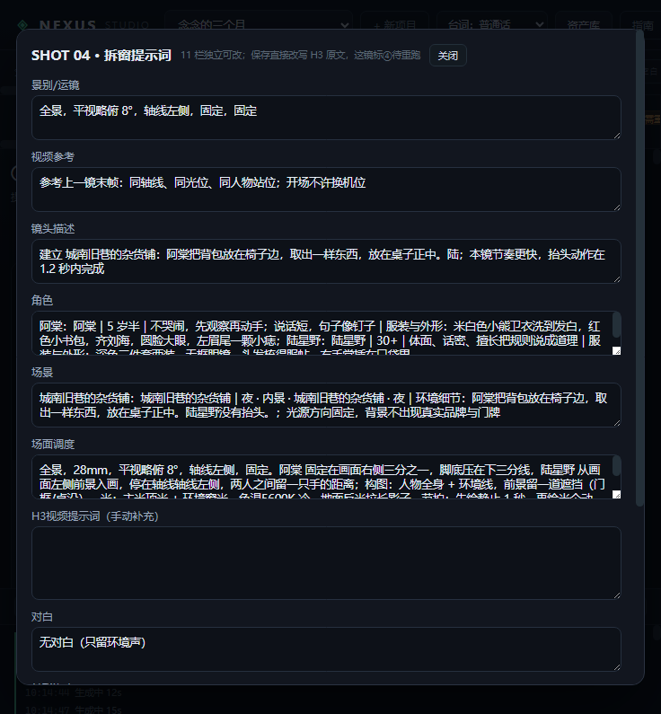
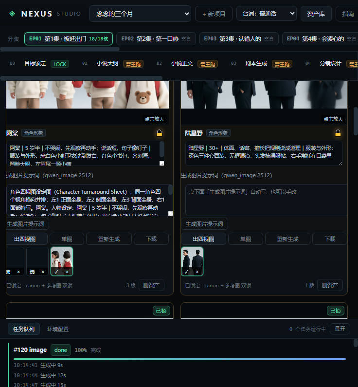
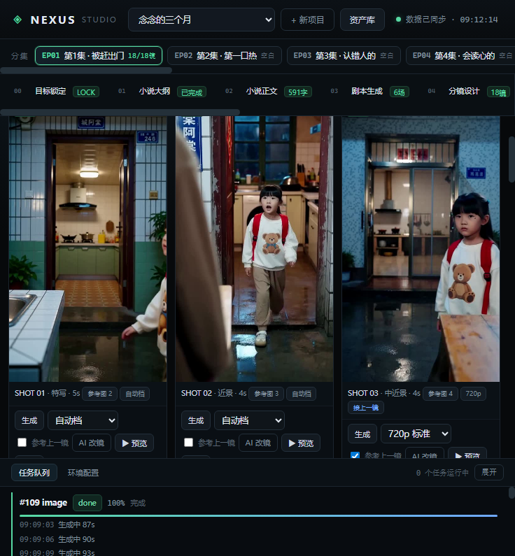
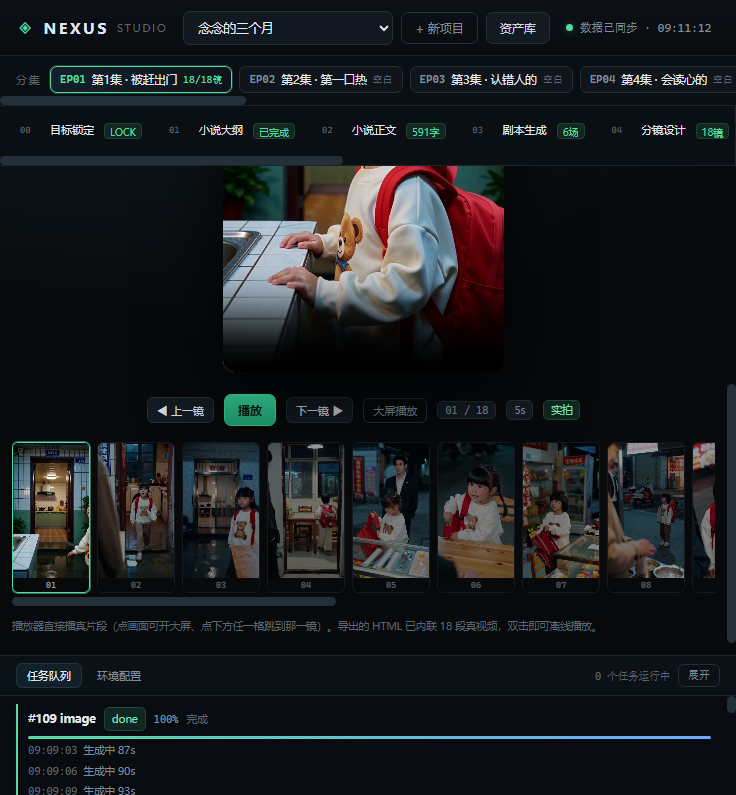
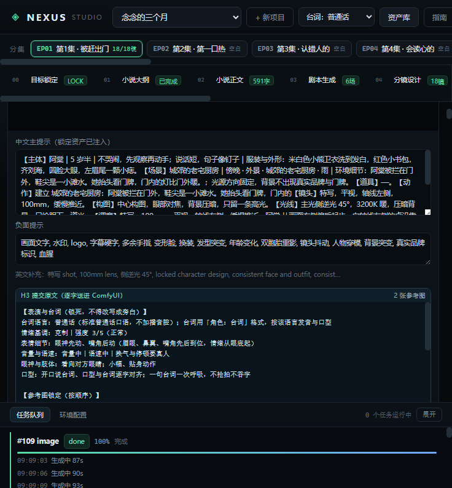

# NEXUS STUDIO · 本地 AI 视频创作系统 · 使用说明

> 版本：2026-11-13 打包（含拆窗提示词 / 随机种子 / 跨镜续接 / 资产批量出图）
> 平台：本机 Windows · 平台端口 18081 · ComfyUI 端口 8188

---

## 0. 这个包是什么
一套在你自己电脑上跑的 AI 短剧流水线，九个步骤一条链：

```
00 目标锁定 → 01 小说大纲 → 02 小说正文 → 03 剧本 → 04 分镜设计
→ 05 场面调度 → 06 视频提示词 → 07 生成视频 → 08 成片合集（+ 09 资产库）
```

核心级联只有一条：**① 资产 / 分镜描述 / 对白改了 → ② 调度 → ③ 提示词 → ④ 视频 全部自动失效，必须按顺序重跑**。不会出现「改了设定但老视频还在装新片」。

目录结构（包内）：

```
NEXUS-STUDIO-AI视频创作系统\
├─ 一键启动.bat            ← 双击这个：同时拉起 ComfyUI(8188) 和平台(18081)
├─ 一键停止.bat            ← 双击停止两个服务
├─ start_services.ps1      ← 启动脚本（bat 调它）
├─ stop_services.ps1
├─ app.py                  ← 平台后端（HTTP + SQLite + 流水线 + 出片）
├─ engine.py               ← 本地创作引擎（大纲/正文/剧本/提示词/六段式）
├─ frames.py               ← 分镜预演 SVG 帧
├─ static\                 ← 前端（index.html / app.js / style.css）
├─ docs\H3_PROMPT_SPEC.md  ← H3 官方提示词规范与映射
├─ workflows\              ← 保存的 ComfyUI 工作流
├─ data\
│  ├─ studio.db            ← 全部项目/资产/分镜/提示词/状态
│  ├─ media\               ← 真视频 mp4 + 参考图 + 缩略图
│  └─ exports\             ← 导出的合集 HTML / 成片 MP4
├─ README.md               ← 开发与变更记录（按轮次）
└─ 使用说明.md              ← 本文件
```

---

## 1. 启动 / 停止

### 启动

双击 **一键启动.bat**。

它会依次做三件事：

1. 检查 ComfyUI 8188：已在跑就跳过；没跑就启动并等它就绪（首次加载 30–60 秒）。
2. 启动平台 18081（`app.py`）。
3. 自动打开浏览器 `http://127.0.0.1:18081/`。

看到下面这段就表示两个都好了：

```
ComfyUI : 在线 8188
平台    : 在线 18081
```

### 停止

双击 **一键停止.bat**。关掉启动窗口不会停服务。

### 日志（出问题先看这里）

| 文件 | 内容 |
|---|---|
| `data\server.out.log` / `server.err.log` | 平台启动与接口错误 |
| `data\videos.log` / `videos.err.log` | 视频任务逐镜日志 |
| `data\comfy.log` | ComfyUI 启动日志 |
| ComfyUI 根目录 `logs\comfyui-auto.log` | ComfyUI 运行日志 |

### 手动启动（脚本失效时）

```powershell
cd "包目录"
python app.py
```

ComfyUI 需另行启动（脚本里已封装；路径见第 8 节）。

---

## 2. 界面怎么读

顶栏从左到右：项目下拉、`+ 新建项目`、台词语言下拉、`资产库`、`指南`、`目标`状态、`本地引擎/API Key`、`ComfyUI` 状态、`数据已同步`。

左侧是 Steps 00–09，每一步右上角有一个状态灯：

- `已完成`：这步产物存在且没过期
- `待重跑` / `需重跑`：上游改过，这步必须重做
- `LOCK` / `锁定`：这一步被锁，防止误改

顶部 EP01…EP12 是分集条，切集只换当前集，不动别的集。

底部是**任务队列**（点「展开」看逐条日志和进度百分比）。所有生成（大纲、正文、剧本、分镜、调度、提示词、视频、出图）都在这里跑，进度条实时更新。

---

## 界面速览（截图在 `docs\screenshots\`）

**06 视频提示词 · 拆窗编辑（11 栏）**



**09 资产库 · 生成图片提示词 / 四视图 / 版本**



**07 生成视频 · 真片卡 + 预览 + 表演面板**



**08 成片合集 · 播放器 + 条带 + 导出**



**H3 提交原文（真正发给模型的字）**



---

## 3. 九步分别怎么用

### 00 目标锁定

填标题、一句话 premise、题材、平台、受众、画幅（默认 9:16）、集数、单集时长、风格锁、禁忌。
风格锁示例：`冷调写实 + 暖光收尾；35mm 与 85mm 交替；轻微手持`。

右侧有 30 种风格卡（真人写实、日系动漫、3D 国风、神话仙侠、赛博朋克、电影感、暗黑漫画、皮影戏…），点一张就填进风格锁，可再手改。

点「锁定目标」后，上游改动会触发下游失效；不锁也能用，但没有这层保护。

### 01 小说大纲

点「生成大纲」→ 三幕结构 + 分集标题 + 每集一句话钩子；角色、场景、道具会自动同步进资产库（这是锁定的起点）。

### 02 小说正文

「生成正文」写本集小说全文（当前 EP01 591 字）；可「深度优化」；有下载按钮，可导出全文。EP01–EP12 分组展示，每集可单独生成/重写。

### 03 剧本

生成场次、动作、对白；对白会进 `shots.dialogue_json`，并逐字进 H3 提示词。可「深度优化修复」。

### 04 分镜设计

按剧本切镜：镜号、时长（4–10s）、景别、机位、运镜、场景、角色、道具、动作、情绪、转场、对白。
每镜有「参考上一镜」勾选（`ref_prev`）。改任意一条 → 05/06/07 失效。

### 05 场面调度

给每镜生成机位/走位/光位/焦段/构图（`blocking_json`）。这层是 ③ 提示词里「场面调度」栏的来源。

### 06 视频提示词

这是最核心的一页，四件事：

**a) 提示词格式**
- `中文自由式`（默认）：主体 + 场景 + 道具 + 动作 + 镜头 + 构图 + 光线 + 风格 + 对白 + 表演
- `H3 官方六段式`：subject_definitions / summary / retention_analysis / detailed_description / overall_soundscape / non_diegetic_music，标签 `<Subject N>`/`<Picture N>`、台词 `<d>[语言] …</d>` + `(S1)(S2)`
- 顶部按钮一键切换；切换后本集全部按新模式重写。

**b) H3 提交原文**
每张卡下半部分灰框就是「逐字送进 ComfyUI 的字符串」，含参考图编号（`图1 = 阿棠`）、表演与台词锁、负面词、硬约束（时长/画幅/24fps/无字幕/无水印/不换脸不换装）。**这里看到什么，模型就收到什么。**

**c) 拆窗编辑（11 栏，手动改）**
每卡「拆窗编辑（11 栏）」按钮打开弹窗：

| 栏 | 作用 |
|---|---|
| 景别/运镜 | 景别 + 机位高度 + 轴线侧 + 运动 |
| 视频参考 | 是否用上一镜末帧、锁什么 |
| 镜头描述 | 这一镜发生什么（动作/事件） |
| 角色 | 出场人物 + canon（外形/服装/体态） |
| 场景 | 地点 + 环境细节 + 时间/内外景 |
| 场面调度 | 走位、焦段、构图、光位/色温 |
| H3视频提示词（手动补充） | 自由追加；写在这里的话优先级最高 |
| 随机种子 | 留空=按提示词 hash；填数字=固定可复现 |
| 对白 | 逐字台词（角色：台词；多语言按语言下拉） |
| 关联资产 | 本镜绑定的角色/道具名单 |
| 场景视角 | 高度/侧面/镜头视角的补充描述 |

打开时已按库里数据预填，**改哪栏存哪栏**；点「保存拆窗」立即改写 H3 原文（不用再跑 06）；这镜会被标「④待重跑」。
「保存并重出④」= 保存后直接提交这一镜的视频任务。

**d) 全镜开启镜头续接**
顶部两个按钮：`全镜开启镜头续接` / `关闭续接`。

开启后第 2 镜起每镜都会：
1. 自动抽上一镜最后一帧，当额外参考图（同轴线/同光位/同人物站位）；
2. 提示词最前面插【衔接上一镜】：上一镜最后一句台词 + 结尾动作 + 「开场第一帧必须与上一镜末帧同轴线、同光位、同人物站位，情绪继续，不许重新起范」。

这是治「每段接不上」的主要手段。开启后整集镜头都会带上跨镜衔接，可随时在顶部开关。

另外两个按钮：
- `补齐 N 镜台词提示词`（黄色提示条）：把「有台词但提示词写成无对白」的历史 bug 修掉。
- `复制 H3 原文` / `复制主提示` / `深度优化` / `重出` / `生成这一镜`。

### 07 生成视频

- 顶部可选**分辨率档位**（`res_tier`：480p / 720p / 1080p，按 H3 允许的尺寸映射）。
- 每镜卡显示：预演帧/真片缩略图、`REAL`/`待重跑`、「▶ 预览」（点击即开灯箱播 mp4）、表演面板、锁提示词、AI 对话（见下）。
- 「全部生成④视频」只跑 `gen_stale` 的镜头（不会把已经合格的镜头重跑一遍）。
- 进度：右下任务队列 + 顶部 jobbar 双处同步，逐镜显示「第 N 镜 · 已用 X 秒 · 百分比」。
- 出片后写回 `shots.video_url` + 缩略图；状态灯转绿。

**单镜 AI 对话改镜**（③/⑦ 都有）：输入框里直接说问题，例如：

- 「这句台词太生硬，改得情绪更强烈点」
- 「镜头推近一些，拍他的表情」
- 「她这时候应该在发抖，不是平静」

Enter 发送，Shift+Enter 换行。AI 会改这一镜的描述/台词/表演，并标记下游失效。

### 08 成片合集

- 三种范围：`全部 N 镜` / `仅已生成 N 镜` / `手选镜头`（点条带格子打勾，只能选已出真片的镜）。右侧实时显示「已选 N 镜 · X 秒」。
- 播放器 `object-fit: contain`，整幅不裁人；上一镜 / 播放 / 下一镜 / 大屏播放 / 18 格条带一屏内可用。
- `导出 HTML 合集`：单文件 HTML，视频 base64 内嵌，可直接发给别人看。
- `ffmpeg 合成 MP4`：按所选镜头顺序拼成一个 mp4。
- 导出完成出现「刚导出的文件」条：`打开 HTML 合集` / `下载 HTML` / `播放 MP4` / `下载 MP4`。
- 文件落在 `data\exports\`。

### 09 资产库（全页）

- 三个分类胶囊：全部 / 角色形象 / 场景资产 / 道具资产；搜索框按名字或设定关键词过滤。
- 每张卡：主图（点击放大灯箱）、canon 文本框（改完 ① 级联失效）、锁定按钮、版本缩略图、选图/删图、下载、删资产。
- `出四视图`（角色，1664×928）/ `单图`（1104×1472）/ `生成本图`（场景 928×1664）/ `重新生成`（reroll，沿用上次画幅）。
- **生成图片提示词**：按 canon/kind/风格生成一段 qwen_image 2512 提示词，存 `assets.prompt_maker`，**可手改**；之后出图直接用这段。
- **批量生成图片（缺图优先）**：缺图的资产逐个排队出图；全都有图时自动改为全部重出，并在提示里说明。
- 已锁资产 = canon + 选中参考图双锁；H3 生成时按「图N = 谁」写进提示词，锁人锁景锁道具。

---

## 4. 台词、语言、表演（对口型相关）

顶栏「台词」下拉支持：普通话 / 粤语 / 客家话 / 英语 / 闽南语 / 四川话。
切语言 → 全部镜头标「待重跑」（因为发音与口型要重出）。

每镜「表演」8 项（可锁死）：情绪基调、强度、表情细节、音量、语速、换气停顿、眼神与肢体、口型要求。
这些会生成【表演与台词（锁死）】段进 H3 原文，防止模型把台词改写成旁白或改情绪。

**边界要讲清楚**：H3 是参考生视频模型，**没有逐音素 lip-sync 保证**。台词逐字进提示词 + 口型指令 + 语言正确，能显著改善，但不能保证 100% 对嘴型；要绝对准只能后期配音对轨（本包未内置 TTS）。

---

## 5. 数据、同步、备份

- 所有状态在 `data\studio.db`（SQLite），刷新页面不丢：当前步、锁定、待重跑、提示词、种子、视频地址都落库。
- 图片/视频在 `data\media`，导出在 `data\exports`。
- 备份：直接复制整个 `data\` 目录即可（建议停服务后复制，避免 WAL 未落盘）。
- 恢复：把 `data\` 放回包目录，启动即可。
- 迁移到别的机器：见第 8 节，先改路径再启动。

---

## 6. 全新部署说明

- 仓库不含 `data\` 目录（数据库、媒体、成片、日志都在本地生成）。首次启动会自动创建空库。
- 从 `00 目标锁定` 开始，按 01 大纲 → 02 正文 → 03 剧本 → 04 分镜 → 05 调度 → 06 提示词 → 07 视频 → 08 合集 顺序逐级生成。
- 改了上游设定后，下游会标「待重跑」；确认后在 07 点「全部生成④视频」即可，只跑待重跑的镜头。
- 本地已有的历史项目、旧片、缓存不会随仓库带走；换机时把旧 `data\` 目录放回包目录即可恢复。

---

## 7. 常见问题

| 现象 | 原因 / 处理 |
|---|---|
| 页面没变化 / 按钮是旧的 | 浏览器缓存。`Ctrl+F5` 强制刷新；静态资源已带版本号 |
| ComfyUI 显示离线 | 双击一键启动；看 `data\comfy.log`；判活必须看 TCP 8188，生成中 HTTP 会超时误判 |
| 点生成没反应 | 看右下任务队列有没有新任务；看 `data\server.err.log` |
| 视频只有一半人 | 播放器已 contain；若片本身画幅不对，检查项目 ratio 与 `res_tier` |
| 口型不准 | 模型能力边界，见第 4 节；先确认台词已进提示词（③ 黄色提示条） |
| 合集点了没文件 | 导出后看「刚导出的文件」条；文件在 `data\exports\` |
| 参考图超过 9 张 | H3 上限 9 图；把不必要道具取消关联 |
| 换集后是空的 | 正常，EP02 之后还没生成内容 |

---

## 8. 换机 / 改路径

源码默认不写任何本机绝对路径，首次在新机器部署时按下面填写：

1. `start_services.ps1` 顶部变量（不用自动拉起 ComfyUI 可留空）：
   - `$croot` ComfyUI 安装根
   - `$cpx` ComfyUI 的 python
   - `$cyaml` 模型路径配置
   - `$cinput` / `$coutput` 输入输出目录
2. 平台设置（界面「环境配置」或 `data\studio.db` 的 `settings` 表）：
   - `comfy_base`（默认 `http://127.0.0.1:8188`）
   - `comfy_input_dir` / `comfy_output_dir`
   - `comfy_python` / `comfy_yaml`
   - `ffmpeg_path` 路径
3. 模型文件名（`app.py` 顶部常量）：`IMG_UNET` / `H3_UNET` / `H3_CLIP` / `H3_VAE` / LoRA 名要和本机一致。
4. 平台 python：脚本优先用 PATH 里的 `python`，找不到再回退 `python` 命令；确保本机已装好 Python 并在 PATH 中。

---

## 9. 最短上手路径（10 分钟）

1. 双击 `一键启动.bat`，等两个「在线」。
2. 打开 `http://127.0.0.1:18081/`。
3. 资产库把角色 / 场景 / 道具出图并锁定。
4. ⑥ 看任意一镜的「H3 提交原文」；点「拆窗编辑」改一句台词或镜头描述，保存。
5. ⑦ 点这一镜「生成这一镜」，看右下进度条走到 100%，点「▶ 预览」看片。
6. ⑧ 选「手选镜头」勾 2 镜 → 导出 HTML → 打开「刚导出的文件」。

跑通这 6 步，整套就归你了。

---

## 10. 单镜头数据包（当前核心结构，2026-11-13）

### 10.1 优先级

**单镜头字段 > 单镜头绑定素材 > 项目全局配置（只兜底）**

- 镜头描述、景别、角度、运镜、焦段、光影、构图、人物动作、场面调度，全部按镜存储。
- 角色图、场景图、道具图、首帧、尾帧、参考视频，全部按镜绑定，不再“全局传一次”。
- 全局风格只在「单镜风格描述」为空时兜底，H3 原文会标注「全局兜底」。

### 10.2 每镜必须有的 A–H 八段

| 段 | 字段 |
|---|---|
| A 镜头基础 | 镜头编号、集数、时长 1–15s、景别、角度、运镜、镜头描述、拍摄方案 |
| B 画面风格 | 单镜风格描述、焦段、光影、构图、色调、镜头质感 |
| C 角色与动作 | 出场人物、主角/配角、每个人物动作、站位、表情、服装、逐镜角色资产绑定 |
| D 场景与道具 | 场景名称、场景参考图、道具清单、道具参考图、环境状态 |
| E 场面调度 | 人物走位、镜头与人物关系、前后景、遮挡、运动方向 |
| F 参考素材 | 首帧、尾帧、上一段参考视频、本镜角色图、场景图、道具图 |
| G Mini3 参数 | 正向/负面提示词、种子、IP 权重、降噪、4/6/8 档位、帧率、画质 |
| H 对白口型 | 说话人、对白文本、旁白、情绪、方言 |

入口：制作向导第③步每镜的 **「数据包」** 按钮。

### 10.3 提交前强校验（缺一项直接拦截）

1. 本镜数据包未确认
2. 镜头描述为空
3. 运镜方式为空
4. 出场人物未绑定角色资产，或角色图文件读不到
5. 场景未绑定场景资产，或场景图文件读不到
6. 镜头里的道具未绑定道具图，或文件读不到
7. 已上传的首帧/尾帧/参考视频文件读不到
8. Mini3 正向提示词为空
9. 种子缺失
10. IP 权重缺失
11. 降噪参数缺失
12. 有对白却缺说话人或对白文本
13. 镜头时长小于配音朗读时长

任一镜不通过：该镜标 `blocked`，任务直接 `failed`，**不提交 ComfyUI 队列**，报错写到任务栏和第④步红色清单。

### 10.4 第④步怎么过

1. 先点 **「一键预绑定并确认全镜数据包」**：按当前角色/场景/道具资产，逐镜生成并保存默认数据包。
2. 有红字就点「去补」，回第③步对应镜的「数据包」改。
3. 全部通过后「下一步」才解锁。

注意：保存数据包会把该镜标记「待重跑」，因为 H3 提交原文已换成结构化单镜版本；旧成片还在，不会被删。

### 10.5 参考图顺序与上限

角色图 → 场景图 → 道具图 → 首帧 → 尾帧 → 参考视频首帧，最多 9 张，按本镜绑定顺序复制进 ComfyUI `input`，不是只传路径。

参考视频目前取首帧作为图像参考，视频本体保留在素材库可追溯；H3 工作流没有视频参考节点。